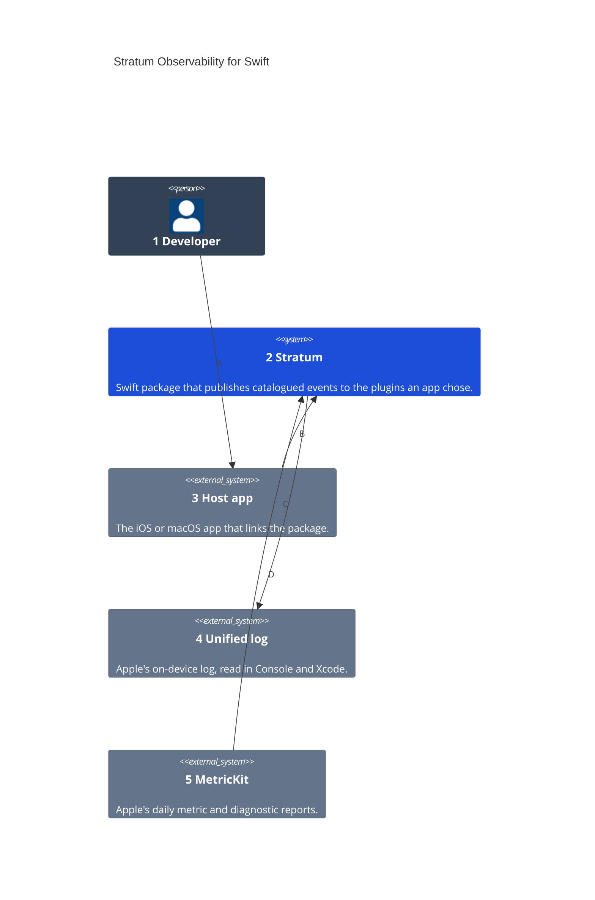
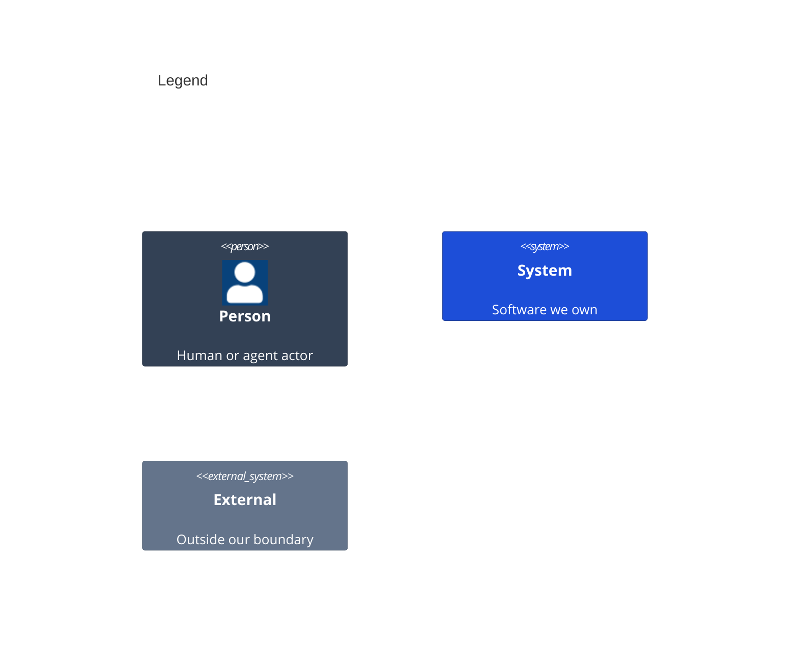

# System Context

Numbers on nodes and letters on arrows match the callout table.

| #   | Description | Why |
| --- | --- | --- |
| 1   | Writes an app, its catalog of events, and the plugins it publishes to. | Requirements name this actor in a Given. |
| 2   | The `Stratum` library and its plugin products. | One way to publish, whatever the destination. |
| 3   | The app a person uses, which links the package. | Events start from what a person does there. |
| 4   | Apple's unified log, through `Logger`. | Local diagnostics with no server, the first plugin in the Plan's order. |
| 5   | Apple's MetricKit, which delivers reports at most once a day. | Launch, memory, crash and hang numbers with no server, second in the order. |
| A   | The developer builds the app with the package. | The app chooses its catalogs and plugins. |
| B   | The app publishes events by key. | One call per event, checked against the catalog. |
| C   | The OSLog plugin writes each event. | It lands beside the app's own `Logger` lines. |
| D   | MetricKit delivers its reports to the MetricKit source. | Reports become events every plugin sees. |
