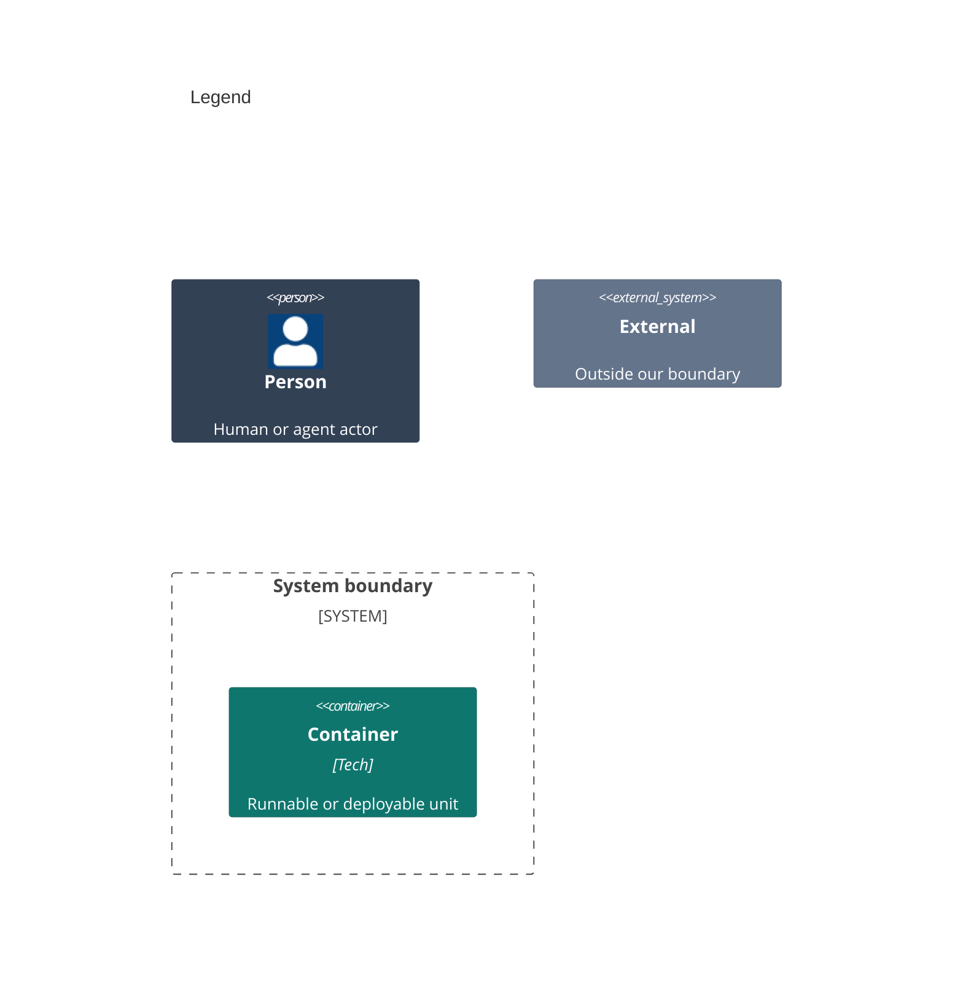

# Containers

A container here is an app that runs on its own. Stratum ships only library products, and they run inside the host app's process, so [03-components.md](03-components.md) shows them. This repo builds no container of its own.

```mermaid
C4Container
    title Stratum Observability for Swift

    Person(dev, "1 Developer")

    System_Boundary(stratum, "2 Stratum") {
    }

    System_Ext(app, "3 Host app", "The iOS or macOS app that links the Stratum products and runs them.")
    System_Ext(log, "4 Unified log", "Apple's on-device log.")
    System_Ext(reports, "5 MetricKit", "Apple's daily reports.")

    Rel(dev, app, "A")
    Rel(app, log, "B")
    Rel(reports, app, "C")

    UpdateElementStyle(dev, $bgColor="#334155", $borderColor="#1e293b", $fontColor="#ffffff")
    UpdateElementStyle(app, $bgColor="#64748b", $borderColor="#475569", $fontColor="#ffffff")
    UpdateElementStyle(log, $bgColor="#64748b", $borderColor="#475569", $fontColor="#ffffff")
    UpdateElementStyle(reports, $bgColor="#64748b", $borderColor="#475569", $fontColor="#ffffff")
```



Numbers on nodes and letters on arrows match the callout table.

| #   | Description | Why |
| --- | --- | --- |
| 1   | The developer from the system context. | Every run starts with this actor. |
| 2   | The package that `Package.swift` declares. | Its products are libraries, not apps. |
| 3   | The app that links `Stratum` and the plugin products it uses. | Stratum runs in its process, on its threads. |
| 4   | Apple's unified log. | Stratum never owns where logs are kept. |
| 5   | Apple's MetricKit. | The system decides when reports arrive. |
| A   | The developer links the package into the app target. | The app owns its catalogs and its subsystem. |
| B   | The app's OSLog plugin writes each event through `Logger`. | Entries sit beside the app's own lines. |
| C   | MetricKit delivers reports to the app's MetricKit source. | Reports become events every plugin sees. |
