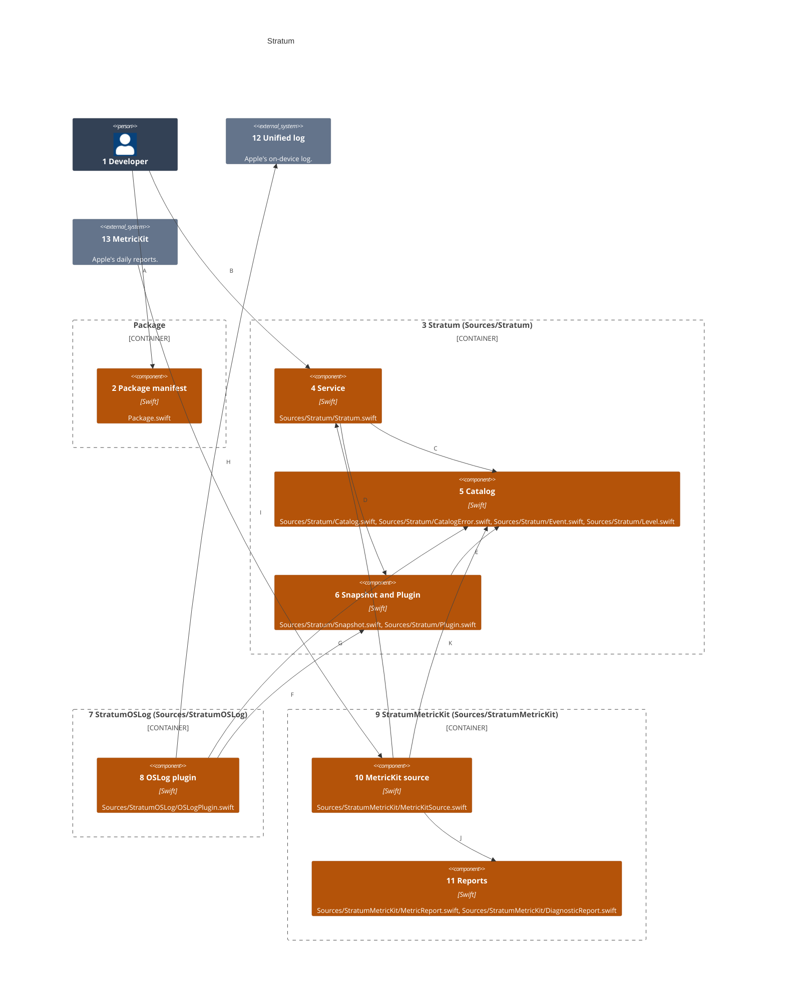
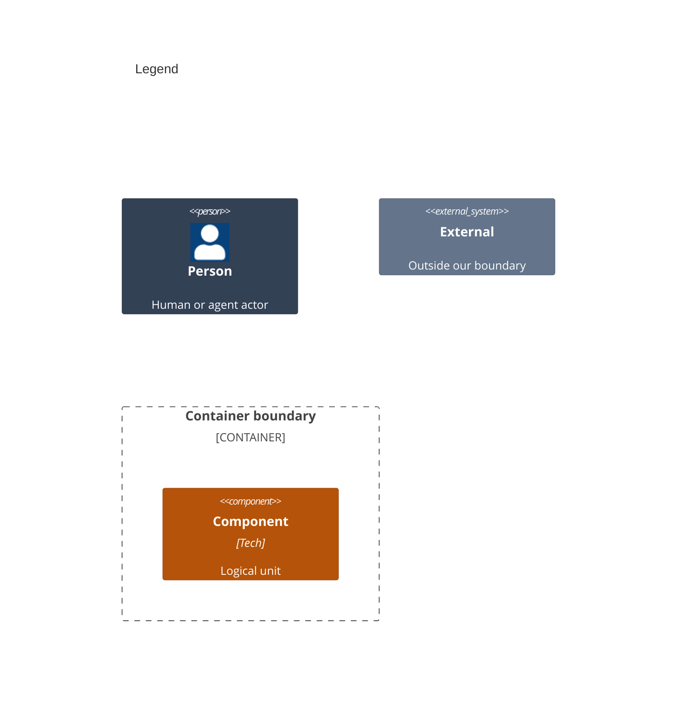

# Components

This splits the library products that run inside the host app of [02-containers.md](02-containers.md) into the files that build them.

Numbers on nodes and letters on arrows match the callout table.

| #   | Description | Why |
| --- | --- | --- |
| 1   | The developer, whose app links the products and calls the service. | Every run starts with this actor. |
| 2   | `Package.swift` declares the three products, for iOS 26 and macOS 26 and later. | An app links only the plugins it uses. |
| 3   | The core library, from `Sources/Stratum`. | Catalogs, context and publishing, with no plugin of its own. |
| 4   | `Stratum` holds catalogs, plugins, context and listeners behind one lock, and publishes. | Safe to call from any thread. |
| 5   | `Catalog`, `CatalogError`, `Event` and `Level`. | An event names its category, level and allowed fields. |
| 6   | `Snapshot` and the `Plugin` protocol. | Every plugin and listener reads one frozen value. |
| 7   | The OSLog product, from `Sources/StratumOSLog`. | First in the Plan's plugin order. |
| 8   | `OSLogPlugin` writes each snapshot through `Logger`. | Private fields stay redacted in the log. |
| 9   | The MetricKit product, from `Sources/StratumMetricKit`. | Second in the Plan's plugin order. |
| 10  | `MetricKitSource` subscribes to MetricKit and publishes what it receives. | The one file that touches MetricKit's subscriber API. |
| 11  | `MetricReport` and `DiagnosticReport` read a report's JSON. | The JSON shape outlives the API Apple is replacing. |
| 12  | The unified log the OSLog plugin writes to. | Read in Console and Xcode. |
| 13  | The MetricKit framework the source subscribes to. | Delivers reports on its own schedule. |
| A   | The app adds the package and links its products. | SwiftPM or an Xcode package reference. |
| B   | The app adds catalogs and plugins, and publishes. | One service per product. |
| C   | The service checks each catalog's events. | A bad key fails when it is added, not when it is used. |
| D   | The service freezes each event into a snapshot for its plugins. | A later context change never reaches it. |
| E   | A snapshot carries the event it froze. | Plugins read the category and level from it. |
| F   | The OSLog plugin conforms to `Plugin`. | Any plugin is added the same way. |
| G   | The OSLog plugin maps the event's level onto the log's. | Errors stay errors in Console. |
| H   | The OSLog plugin writes under the app's subsystem. | Entries sit beside the app's own lines. |
| I   | MetricKit hands the source each day's payloads. | The system decides when. |
| J   | The source reads each payload's JSON. | Saved reports replay through the same path. |
| K   | The source declares its own catalog. | Its keys are fixed and checked like any other. |
| L   | The source publishes through the service. | Reports reach every plugin the app chose. |
