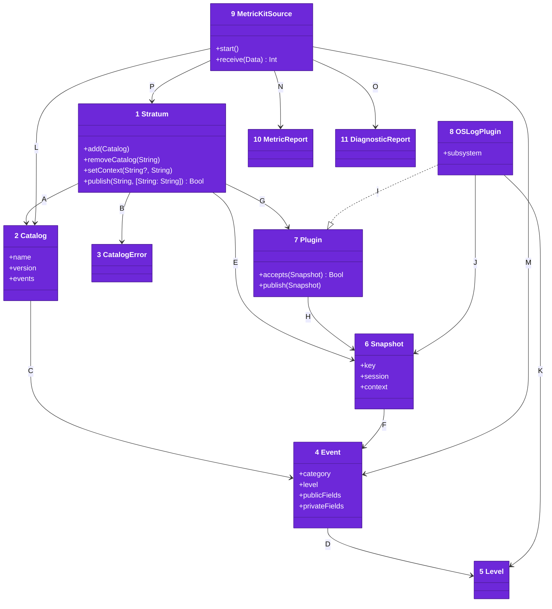
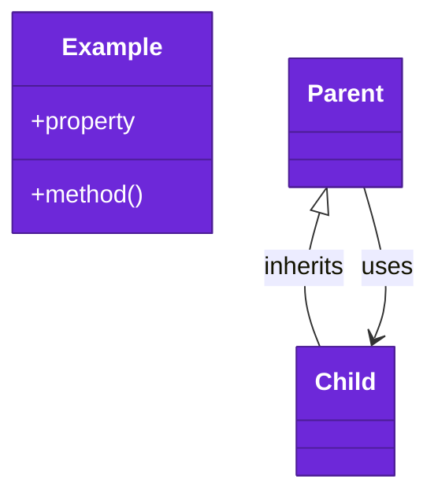

# Code

The types an app uses, from [03-components.md](03-components.md). `Package.swift` declares the three products, for iOS 26 and macOS 26 and later, in Swift 6 language mode.

Numbers on classes and letters on relationships match the callout table.

| #   | Description | Why |
| --- | --- | --- |
| 1   | `Stratum` in [Stratum.swift](../../Sources/Stratum/Stratum.swift), the service an app publishes through. It also adds plugins and listeners. | One `Sendable` type, safe from any thread. |
| 2   | `Catalog` in [Catalog.swift](../../Sources/Stratum/Catalog.swift), a named and versioned set of events by key. | A key belongs to one catalog. |
| 3   | `CatalogError` in [CatalogError.swift](../../Sources/Stratum/CatalogError.swift), an invalid event or a duplicate key. | Adding a catalog fails at once, naming the event. |
| 4   | `Event` in [Event.swift](../../Sources/Stratum/Event.swift), with its category, level and allowed fields. | The category matches a `Logger` category the app already uses. |
| 5   | `Level` in [Level.swift](../../Sources/Stratum/Level.swift), from debug to fault. | Each plugin maps it onto its own scale. |
| 6   | `Snapshot` in [Snapshot.swift](../../Sources/Stratum/Snapshot.swift), one published event with its context and launch session. | Plugins never read live state. |
| 7   | `Plugin` in [Plugin.swift](../../Sources/Stratum/Plugin.swift), a destination with a name. | A second plugin with the same name replaces the first. |
| 8   | `OSLogPlugin` in [OSLogPlugin.swift](../../Sources/StratumOSLog/OSLogPlugin.swift). | Writes the key and public fields in the clear and the private fields redacted. |
| 9   | `MetricKitSource` in [MetricKitSource.swift](../../Sources/StratumMetricKit/MetricKitSource.swift). | `start()` subscribes; `receive` takes a report's JSON. |
| 10  | `MetricReport` in [MetricReport.swift](../../Sources/StratumMetricKit/MetricReport.swift). | The period, app version and peak memory of a metric report. |
| 11  | `DiagnosticReport` in [DiagnosticReport.swift](../../Sources/StratumMetricKit/DiagnosticReport.swift). | One field set per crash and per hang. |
| A   | The service holds catalogs and checks each one it adds. | Every key is checked once. |
| B   | A bad or duplicate key throws a `CatalogError`. | The developer reads which event to fix. |
| C   | A catalog maps each key to its event. | Fields a key's event does not name are dropped. |
| D   | An event has one level. | Plugins read it to filter and to map. |
| E   | Publishing builds one snapshot. | Listeners and plugins share it. |
| F   | `Snapshot.event` holds the `Event` it froze. | Plugins read the category from it. |
| G   | The service hands the snapshot to each plugin that accepts it. | A plugin can take only some events. |
| H   | A plugin receives snapshots. | It never sees the service's state. |
| I   | `OSLogPlugin` conforms to `Plugin`. | It is added like any other plugin. |
| J   | The OSLog plugin writes one snapshot per log entry. | One event, one line. |
| K   | The OSLog plugin maps each level onto the log's. | Errors stay errors in Console. |
| L   | The source declares its catalog. | Its keys are checked like any other. |
| M   | The source describes each of its events. | Report fields are public numbers, never content. |
| N   | The source reads a metric report's JSON. | JSON that is not a report publishes nothing. |
| O   | The source reads a diagnostic report's JSON. | Each crash and hang becomes its own event. |
| P   | The source adds its catalog and publishes through the service. | Its events reach the app's plugins. |

## Tests

`swift test` runs `Tests/StratumRequirements`, one Swift Testing suite per requirement doc, nested in one serialized `Requirements` suite. A person's tap drives each publish through a one-button screen that `UITestingLibrary` draws and taps. The OSLog tests read the entries back from the unified log of the test process. The MetricKit tests replay reports saved in `Tests/StratumRequirements/Reports`, since the system delivers real ones only on a device, at most once a day.
