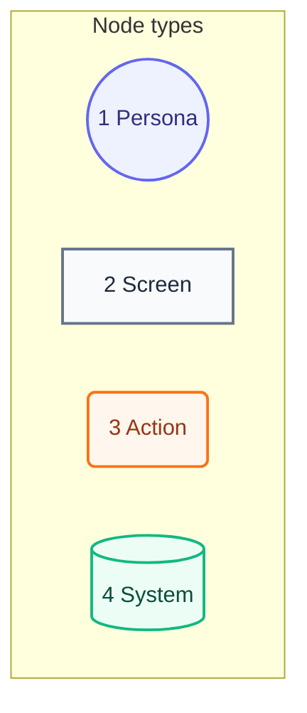
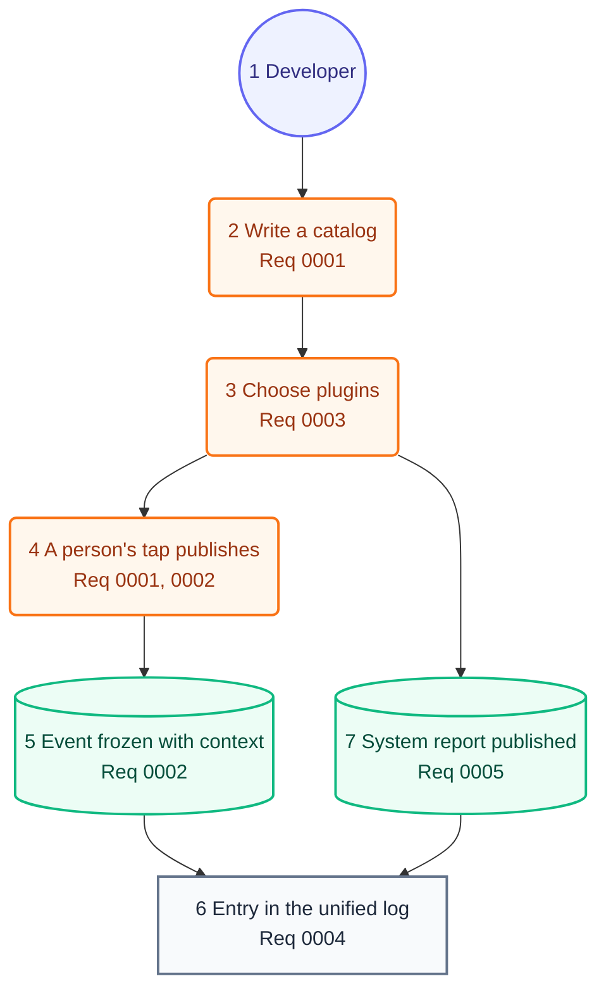

# User Journey

## Legend

Numbers match the callout table.

| #   | Description | Why |
| --- | ----------- | --- |
| 1   | Persona     | A person the system context declares. |
| 2   | Screen      | What the person sees. |
| 3   | Action      | What the person does. |
| 4   | System      | What the product does in reply. |

## Journey

Numbers match the callout table.

| #   | Description | Type | Why |
| --- | ----------- | ---- | --- |
| 1   | The developer. | Persona | Same person as the system context. |
| 2   | Writes the catalog of events the app may publish. | Action | Only catalogued keys publish. |
| 3   | Adds the OSLog plugin and the MetricKit source. | Action | The Plan's first two plugins, both local. |
| 4   | A person uses the app, and its code publishes a key. | Action | Events start from what a person does. |
| 5   | Stratum freezes the event with its context and session. | System | Every plugin reads the same value. |
| 6   | The developer reads the entry in Console or Xcode. | Screen | Private fields stay hidden there. |
| 7   | MetricKit's daily report becomes events. | System | Crashes and hangs show beside the app's own events. |
